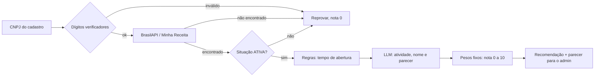

# Relatório de PLN: análise do CNPJ de fornecedores com IA no Collect Express

**Projeto:** Collect Express, app de locação de caçambas de entulho (TCC, Fatec Mauá, DSM)

**Integrantes:**

- Gabriel Andrade Ferreira
- Leonardo Dias dos Santos
- Pedro Henrique Batista dos Santos

**Repositórios:**

- API (Node.js): https://github.com/CollectOrganization/CollectExpressAPI
- App (Flutter): https://github.com/CollectOrganization/App_CollectExpress_Front_C_Flutter

Branch das duas: `feature/analise-cnpj-pln`.

---

## 1. Objetivo: que problema o PLN resolve

No Collect Express, quem aluga caçambas (o "caçambeiro") se cadastra com o CNPJ da empresa. A conta fica **pendente** até um administrador aprovar. Antes desta funcionalidade, o administrador só via o que o próprio fornecedor tinha digitado. Para saber se a empresa existia, se estava ativa e se trabalhava mesmo com caçambas, ele precisava consultar o CNPJ por fora e ler as atividades registradas na Receita.

A parte difícil dessa conferência é **texto**:

- **As atividades da empresa (CNAE) são descrições em linguagem natural**, e as compatíveis com locação de caçambas quase nunca têm a palavra "caçamba". Exemplos: "Coleta de resíduos não-perigosos" (3811-4/00) e "Aluguel de máquinas e equipamentos para construção sem operador, exceto andaimes" (7732-2/01). A tabela CNAE tem mais de 1.300 subclasses, e uma busca por palavra-chave erra esses casos.
- **O nome digitado no cadastro raramente é igual à razão social.** "JR Caçambas" pode ser o nome fantasia da "JR LOCACAO DE CACAMBAS LTDA". A razão social de um MEI costuma ser o nome do dono seguido de números. Comparar os dois exige entender abreviação, sigla e contexto, e não só igualdade de texto.
- **O administrador precisa de uma explicação curta**, e não de um JSON da Receita.

O PLN resolve esses três pontos. A análise roda sozinha logo depois do cadastro. Quando o administrador abre o cadastro pendente, já encontra uma **nota de 0 a 10**, uma **recomendação** (aprovar, revisar ou recusar), as checagens que formaram a nota e um **parecer em texto**. A decisão continua sendo do administrador: a IA recomenda, não aprova.

## 2. Técnica usada

A solução é um **pipeline híbrido de regras e LLM**. Cada parte faz o que faz melhor:



| Etapa | Técnica | Por que essa técnica |
|---|---|---|
| CNPJ válido, encontrado e ativo; tempo de abertura | Regras determinísticas | São fatos objetivos. Regra é exata, grátis e explicável. Quando reprova, o LLM nem é chamado. |
| Atividade compatível com o perfil | **Classificação de texto zero-shot com LLM** (3 classes: `PRINCIPAL_COMPATIVEL`, `SECUNDARIA_COMPATIVEL`, `INCOMPATIVEL`) | O critério é semântico ("serve para quem aluga caçamba?"). Não há base rotulada para treinar um classificador, e o LLM entende a descrição do CNAE sem treino. |
| Nome do cadastro x Receita | **Correspondência de entidades (entity matching) com LLM** (3 classes: `CONSISTENTE`, `PARCIAL`, `INCONSISTENTE`) | Trata sigla, abreviação, acento, sufixo (LTDA, ME) e razão social de MEI, que uma comparação de strings não trata. |
| Parecer para o administrador | **Geração de linguagem natural (NLG)** | Resume os dados e as checagens em 2 a 4 frases em português. |
| Formato da resposta | **Saída estruturada com JSON Schema** | O LLM só pode devolver os rótulos permitidos (enum) e os campos esperados, então o código lê a resposta sem adivinhar. |

Outros pontos de projeto:

- **Grounding em dados recuperados.** O LLM não "pesquisa" nem usa memória sobre a empresa. Ele recebe os dados oficiais consultados na hora e responde com base neles. É o mesmo princípio do RAG (recuperar um documento e gerar condicionado a ele), mas com uma consulta direta por chave (o CNPJ), sem base vetorial nem embeddings.
- **A nota não é escolhida pelo LLM.** O LLM devolve rótulos, e o código converte esses rótulos em pontos fixos:

  | Critério | Pontos |
  |---|---|
  | Situação cadastral ATIVA | 35 |
  | Tempo de abertura (2 anos ou mais: 15; de 6 meses a 2 anos: 8; menos de 6 meses: 0) | 15 |
  | Atividade (principal compatível: 40; só secundária: 25; incompatível: 0) | 40 |
  | Nome (confere: 10; em parte: 5; não confere: 0) | 10 |

  Nota = pontos ÷ 10. A recomendação é **recusar** se a atividade for incompatível ou a nota for menor que 5, e **aprovar** se a nota for 7 ou mais e o nome não for inconsistente. Nos outros casos, é **revisar**. Um nome que não confere segura a recomendação em "revisar" mesmo com nota alta, porque é o sinal típico de alguém usando o CNPJ de outra empresa.

  Com isso, a mesma classificação sempre gera a mesma nota, e o administrador vê de onde saiu cada ponto.
- **Engenharia de prompt.** O prompt de sistema descreve o app, define cada rótulo com critérios e exemplos de casos difíceis (MEI, nome fantasia) e proíbe o modelo de dar nota ou dizer que aprovou. Os dados da empresa vão delimitados em `<dados_cnpj>`, e o modelo é instruído a tratá-los como dados e nunca como instruções (defesa contra *prompt injection* por uma razão social maliciosa).
- **Minimização de dados (LGPD).** O quadro de sócios, o e-mail e o telefone que a Receita devolve são descartados antes de ir para o LLM e para o banco.
- **Humano no circuito.** O sistema recomenda e explica; aprovar ou recusar é sempre um clique do administrador.

## 3. Ferramentas, bibliotecas, modelos e APIs

| Item | Uso |
|---|---|
| **Claude Opus 5.5** (`claude-opus-5-5`), da Anthropic | LLM das classificações e do parecer. Esforço `low` (é classificação de texto curto), saída estruturada por JSON Schema e *fallback* do lado do servidor (se o modelo recusar por engano, a própria API tenta outro). O modelo pode ser trocado pela variável `ANALISE_CNPJ_MODELO`. |
| **SDK oficial `@anthropic-ai/sdk`** (Node.js, versão 1.14) | Chamada ao modelo (`client.beta.messages.create`) e erros tipados (chave inválida, limite de uso, falha de conexão). |
| **BrasilAPI**, rota `GET /api/cnpj/v1/{cnpj}` | Dados abertos do CNPJ na Receita Federal: razão social, nome fantasia, situação cadastral, data de abertura e CNAE principal e secundários. Gratuita e sem chave. |
| **Minha Receita** (`minhareceita.org`) | Reserva com o mesmo formato, usada quando a BrasilAPI falha. |
| Node.js 24, Express 5, PostgreSQL (Neon) | API REST. A análise fica salva em `analises_cnpj`, numa coluna JSONB. |
| Flutter / Dart, Riverpod e Dio | Tela do administrador. |
| Jest e `flutter_test` | Testes automatizados (o LLM é simulado nos testes). |

## 4. Onde está no código

### API (repositório CollectExpressAPI)

| Arquivo | Função ou trecho | O que faz |
|---|---|---|
| `src/services/analiseCnpjService.js` | `cnpjValido` | Confere os dígitos verificadores. |
| | `consultarCnpj` | Consulta a BrasilAPI e, se ela falhar, a Minha Receita. |
| | `resumirDadosReceita` | Fica só com os campos úteis e descarta sócios, e-mail e telefone. |
| | `avaliarRegras` | Regras de situação cadastral e tempo de abertura. |
| | `INSTRUCOES` | **Prompt de sistema** com as tarefas e a definição dos rótulos. |
| | `ESQUEMA_RESPOSTA` | **JSON Schema** da resposta do LLM. |
| | `montarMensagem` | Monta a mensagem com o perfil, o nome digitado e os dados delimitados. |
| | `analisarTextoComIa` | **A chamada ao LLM**: parâmetros, tratamento de recusa e de resposta cortada, leitura e validação do JSON. |
| | `analisarCnpj` | Orquestra o pipeline, aplica os pesos (`PESOS`), calcula a nota e monta a resposta. |
| | `recomendar` | Regra que transforma nota e rótulos em aprovar, revisar ou recusar. |
| | `gerarESalvarAnalise` / `agendarAnaliseDoCadastro` | Salva no banco. Dispara a análise em segundo plano logo depois do cadastro. |
| `src/controllers/analiseCnpjController.js` | `obter`, `gerar` | `GET` e `POST /api/usuarios/:id/analise-cnpj` (só ADMIN). |
| `src/routes/usuariosRoutes.js` | rotas `/:id/analise-cnpj` | Registro das rotas com autenticação e perfil ADMIN. |
| `src/controllers/authController.js` | `register` | Chama `agendarAnaliseDoCadastro` quando o cadastro fica pendente. |
| `src/scripts/analiseCnpjMigration.js` | | Cria a tabela `analises_cnpj` (`npm run migrate:analise-cnpj`). |
| `test/analiseCnpjService.test.js`, `test/analiseCnpjController.test.js` | | 23 testes: caçambeira ativa, padaria, nome que não confere, CNPJ inválido, inexistente e baixado, fonte reserva, falta de chave, resposta fora do formato. |

### App (repositório App_CollectExpress_Front_C_Flutter)

| Arquivo | O que faz |
|---|---|
| `lib/features/admin/domain/models/analise_cnpj.dart` | Modelo da análise (nota, recomendação, checagens, classificações, parecer, dados da Receita). |
| `lib/features/admin/data/admin_repository.dart` | `analiseCnpjSalva` (GET) e `gerarAnaliseCnpj` (POST, com espera de até 90 s por causa do LLM). |
| `lib/features/admin/presentation/widgets/analise_cnpj_sheet.dart` | Tela da análise: nota, recomendação, dados da Receita, "como a nota foi calculada", justificativas da IA, pontos de atenção, parecer e os botões Aprovar, Recusar e Refazer análise. |
| `lib/features/admin/presentation/pages/gestao_usuarios_page.dart` | Opção "Análise do CNPJ com IA" no menu do fornecedor (`_abrirAnaliseCnpj`). |
| `test/features/analise_cnpj_test.dart` | 5 testes do repositório e da tela. |

## 5. Exemplos de entrada e saída

### 5.1 Empresa de caçambas ativa (fluxo completo)

Dados fictícios, os mesmos do teste automatizado. A mensagem abaixo é a que o código monta de verdade (saída de `montarMensagem`). A resposta do LLM do item 3 é a resposta simulada do teste, usada aqui para mostrar o formato.

**1. Entrada do administrador:** cadastro pendente de "JR Caçambas", CNPJ 11.222.333/0001-81.

**2. Mensagem enviada ao LLM**, junto com o prompt de sistema `INSTRUCOES`:

```text
Perfil do cadastro: fornecedor de caçambas, que aluga caçambas estacionárias para entulho e resíduos de construção, entrega e retira as caçambas com caminhão e leva os resíduos para a destinação.
Nome digitado no cadastro: "JR Caçambas"

<dados_cnpj>
{
  "razao_social": "JR LOCACAO DE CACAMBAS LTDA",
  "nome_fantasia": "JR CACAMBAS",
  "situacao_cadastral": "ATIVA",
  "data_inicio_atividade": "2019-03-10",
  "cnae_principal": { "codigo": "3811-4/00", "descricao": "Coleta de resíduos não-perigosos" },
  "cnaes_secundarios": [
    { "codigo": "7732-2/01", "descricao": "Aluguel de máquinas e equipamentos para construção sem operador, exceto andaimes" }
  ],
  "natureza_juridica": "Sociedade Empresária Limitada",
  "porte": "MICRO EMPRESA",
  "municipio": "SAO PAULO",
  "uf": "SP",
  "opcao_pelo_mei": false
}
</dados_cnpj>

Checagens automáticas já feitas:
- Situação cadastral: ATIVA
- Tempo de abertura: Aberta há 7 anos
```

O sócio (JOSE ROBERTO DA SILVA) e o e-mail que vieram da Receita não aparecem: foram descartados antes.

**3. Saída do LLM** (JSON validado pelo schema):

```json
{
  "atividade": {
    "classificacao": "PRINCIPAL_COMPATIVEL",
    "cnaes_compativeis": ["3811-4/00", "7732-2/01"],
    "justificativa": "Coleta de resíduos não perigosos é o serviço de quem retira entulho em caçambas, e o aluguel de equipamentos para construção cobre a locação da caçamba."
  },
  "nome": {
    "classificacao": "CONSISTENTE",
    "justificativa": "\"JR Caçambas\" corresponde ao nome fantasia JR CACAMBAS; a diferença é só de acento e caixa."
  },
  "pontos_de_atencao": ["Conferir se a empresa tem licença para transportar resíduos da construção civil."],
  "parecer": "A empresa está ativa há 7 anos e tem como atividade principal a coleta de resíduos não perigosos, compatível com a locação de caçambas. O nome informado bate com o nome fantasia registrado na Receita. Vale conferir a licença de transporte de resíduos antes da aprovação."
}
```

**4. Saída da API para o app** (resumida; gerada pelo código a partir da resposta acima):

```json
{
  "cnpj": "**.***.333/0001-81",
  "nota": 10,
  "recomendacao": "APROVAR",
  "resumo": "Dados conferem com o perfil.",
  "checagens": [
    { "item": "Situação cadastral", "resultado": "ATIVA", "pontos": 35, "maximo": 35 },
    { "item": "Tempo de abertura", "resultado": "Aberta há 7 anos", "pontos": 15, "maximo": 15 },
    { "item": "Atividade compatível (IA)", "resultado": "Atividade principal compatível", "pontos": 40, "maximo": 40 },
    { "item": "Nome confere com a Receita (IA)", "resultado": "Nome confere", "pontos": 10, "maximo": 10 }
  ],
  "parecer": "A empresa está ativa há 7 anos e tem como atividade principal ...",
  "fonte": "BrasilAPI",
  "ia": { "usada": true, "modelo": "claude-opus-5-5" }
}
```

### 5.2 Outros casos (cobertos pelos testes automatizados)

| Entrada | O que acontece | Nota | Recomendação |
|---|---|---|---|
| Empresa de caçambas ativa há 7 anos, nome confere | Fluxo completo do item 5.1 | 10 | Aprovar |
| Padaria ativa se cadastrando como caçambeiro | LLM classifica a atividade como `INCOMPATIVEL` ("Fabricação de produtos de padaria...") | 5 | Recusar |
| Caçambeira ativa, mas nome digitado de outra empresa | LLM classifica o nome como `INCONSISTENTE` | 9 | Revisar |
| Caçambeira aberta há 2 meses | Perde os pontos de tempo e ganha o alerta "ainda não tem histórico" | 8,5 | Aprovar |
| CNPJ com situação BAIXADA | Reprovado pela regra, **sem chamar o LLM** | 0 | Recusar |
| CNPJ com dígito verificador errado | Reprovado sem consultar a Receita nem o LLM | 0 | Recusar |
| CNPJ que não existe na Receita | Reprovado pela regra | 0 | Recusar |
| API sem chave do LLM configurada | Só as regras rodam. Sem nota, a tela pede conferência manual da atividade e mostra o motivo. | – | Revisar |

### 5.3 Consulta real à Receita (modo sem IA)

Consulta real à BrasilAPI com um CNPJ público (Banco do Brasil, 00.000.000/0001-91) e a chave do LLM desligada:

```json
{
  "nota": null,
  "recomendacao": "REVISAR",
  "resumo": "Empresa ativa. Falta conferir a atividade.",
  "fonte": "BrasilAPI",
  "checagens": [
    { "item": "Situação cadastral", "resultado": "ATIVA", "pontos": 35, "maximo": 35 },
    { "item": "Tempo de abertura", "resultado": "Aberta há 60 anos", "pontos": 15, "maximo": 15 }
  ],
  "ia": { "usada": false, "motivo": "IA não configurada: defina ANTHROPIC_API_KEY no .env da API." }
}
```

Esse caso mostra por que o LLM é necessário. As regras confirmam que o CNPJ existe e está ativo, mas não conseguem dizer que "Bancos múltiplos, com carteira comercial" não tem nada a ver com caçambas. Com o LLM ligado, essa atividade cai em `INCOMPATIVEL`.

## 6. Limitações e possíveis melhorias

### Limitações

- **Não medimos a acurácia.** Não montamos um conjunto de CNPJs rotulados à mão, então não temos precisão e revocação das classificações do LLM. Os testes automatizados conferem o pipeline com respostas simuladas, e não a qualidade do modelo.
- **O LLM não é determinístico** e pode errar em casos de fronteira. Exemplo: "Transporte rodoviário de carga" serve ou não para um caçambeiro? Os pesos fixos e a decisão humana limitam o impacto, mas não eliminam o erro.
- **O CNAE é autodeclarado.** Uma empresa pode ter o CNAE certo sem operar caçambas, ou operar com o CNAE errado. A análise não confere licença ambiental, alvará, controle de transporte de resíduos (CTR), frota nem reclamações de clientes.
- **Dependência de serviços externos.** A BrasilAPI e a Minha Receita são gratuitas e sem garantia de disponibilidade. A base da Receita tem defasagem de atualização. O LLM é um serviço pago com chave: sem ela, o sistema funciona só com as regras.
- **Custo e tempo.** Cada análise faz uma chamada ao modelo e leva alguns segundos. Estimamos alguns centavos de dólar por análise, mas não medimos. Como a análise roda em todo cadastro de fornecedor, cadastros falsos em massa geram custo (há limite de requisições no cadastro).
- **Prompt injection.** Uma razão social ou nome digitado pode tentar dar ordens ao modelo. As defesas (dados delimitados, saída restrita a rótulos por schema, nota calculada pelo código, decisão humana) reduzem o risco, mas não o zeram.
- **Privacidade.** Os dados públicos da empresa e o nome digitado são enviados a um provedor externo (Anthropic). Sócios, e-mail e telefone não são enviados.
- **CNPJ alfanumérico.** A Receita Federal adotou o CNPJ com letras para novas inscrições a partir de julho de 2026. O cadastro do app e a validação de dígitos aceitam só números.
- **Escopo da tela.** A API analisa caçambeiros e parceiros de reciclagem, mas o app só mostra a análise para caçambeiros.
- **Análise em segundo plano sem fila.** Se o servidor reiniciar no meio da análise do cadastro, ela se perde. O administrador gera de novo com "Refazer análise".

### Possíveis melhorias

1. **Avaliação com dados rotulados.** Montar de 50 a 100 CNPJs reais (caçambeiras, recicladoras e empresas de outros ramos), rotular à mão e medir precisão, revocação e F1 das duas classificações. Comparar com uma linha de base por lista fixa de CNAEs e por palavras-chave.
2. **Exemplos no prompt (few-shot)** com os casos em que o modelo errar na avaliação.
3. **Comparar modelos e níveis de esforço** na mesma avaliação, para achar o mais barato que mantém a qualidade.
4. **Reanálise periódica** dos fornecedores já aprovados, para pegar empresas que foram baixadas depois da aprovação.
5. **Mais fontes de dados:** licença ambiental estadual, cadastro de transportadores de resíduos da prefeitura e avaliações dos próprios clientes no app (análise de sentimentos dos comentários).
6. **Fila de tarefas** para a análise do cadastro, com nova tentativa automática.
7. **Mostrar a análise também para parceiros de reciclagem** no app e aceitar o CNPJ alfanumérico.
